# Network Traffic Analyzer

A Python/Scapy cyber-security monitoring tool built as a capstone project. It captures network
packets, stores them in SQLite, analyses traffic patterns, detects suspicious behaviour with simple
rules, and shows everything on a live Streamlit dashboard with exportable reports.

> **Educational and defensive only.** Capture and test only on your own machine/lab network.

## Screenshots

Captured on a Kali Linux VM: ~138K real packets (460 MB), with port-scan, SSH brute-force and traffic-spike attacks generated against the machine itself.

**Dashboard - overview** (packets/sec, bandwidth, traffic direction, top ports)

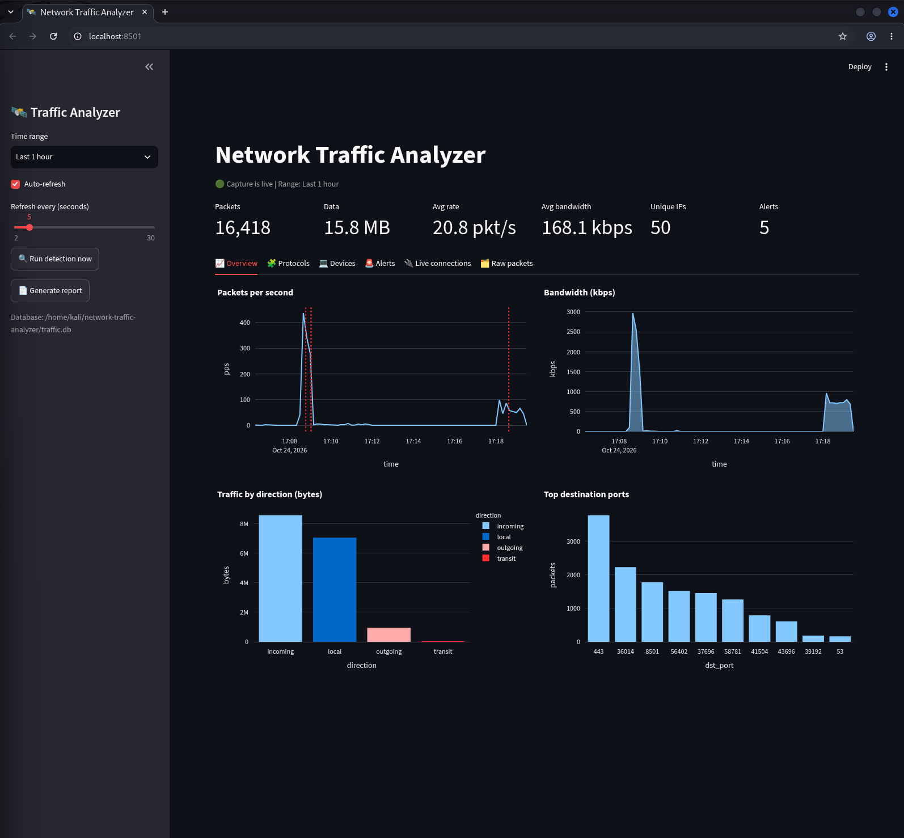

**Dashboard - alerts** (alerts by type, timeline and full alert log)

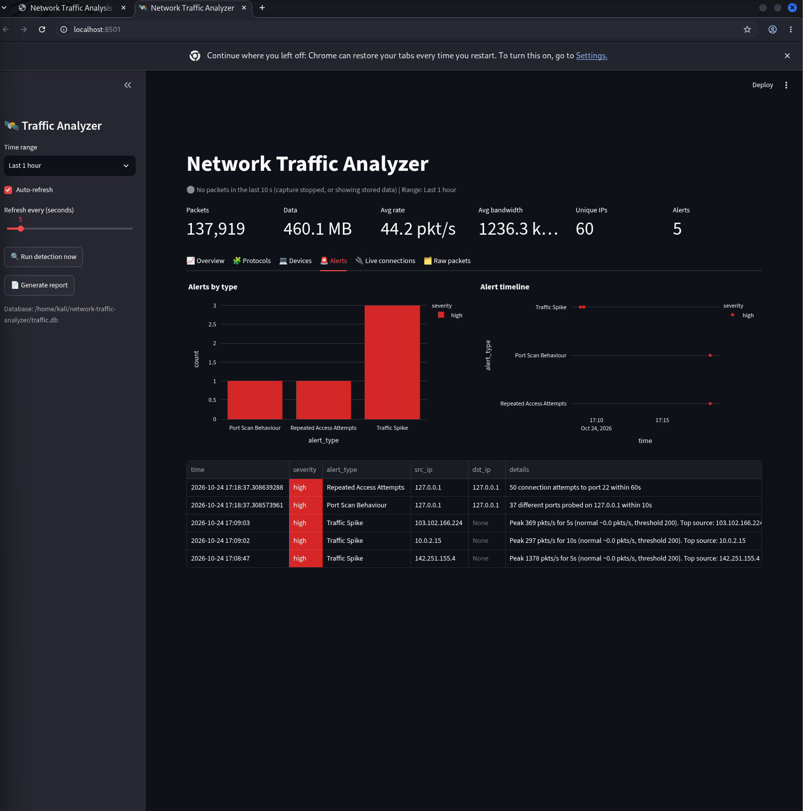

**Detector catching attacks in real time** (`detector.py --watch`)

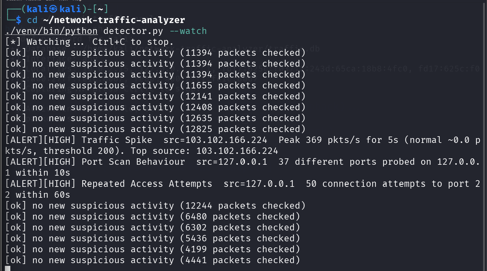

| Protocols | Devices |
|---|---|
| 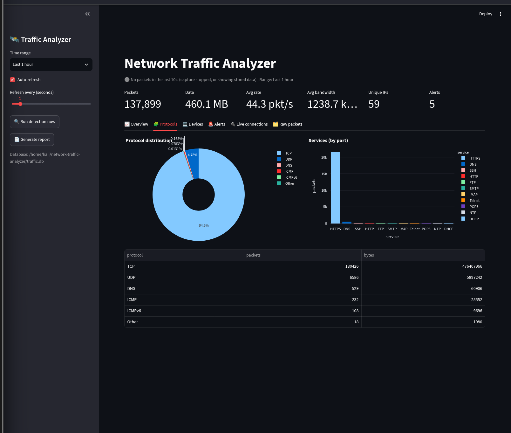 | 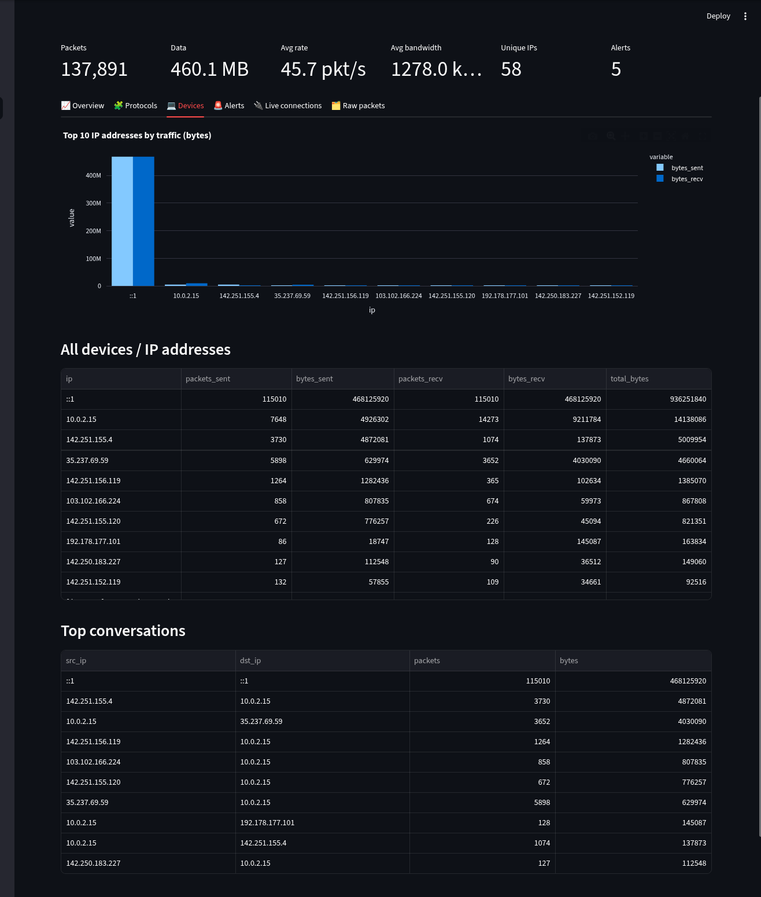 |

<details>
<summary>More screenshots: capture, test traffic, live connections, raw packets, HTML report</summary>

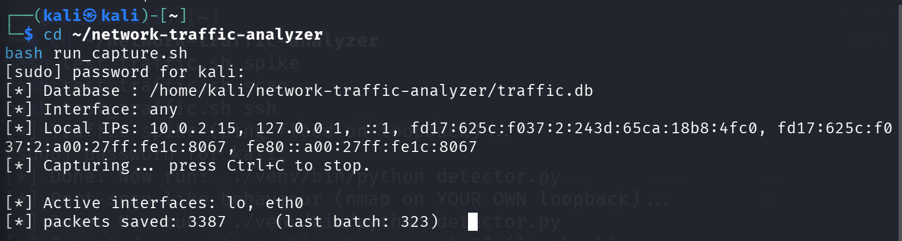
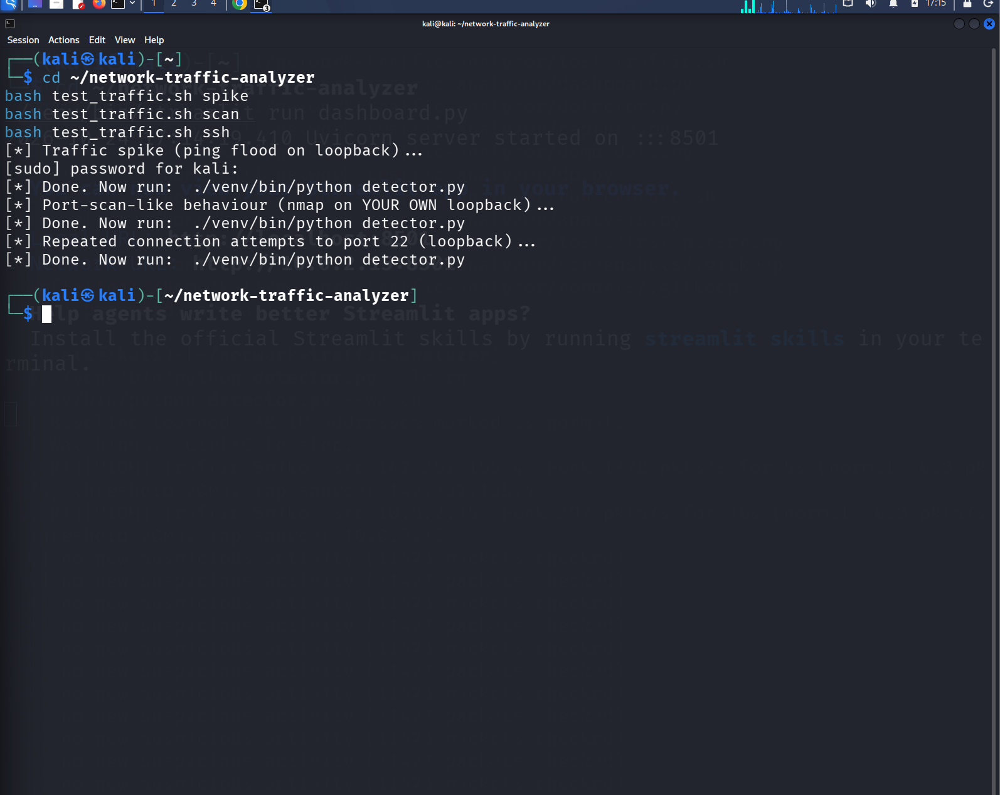
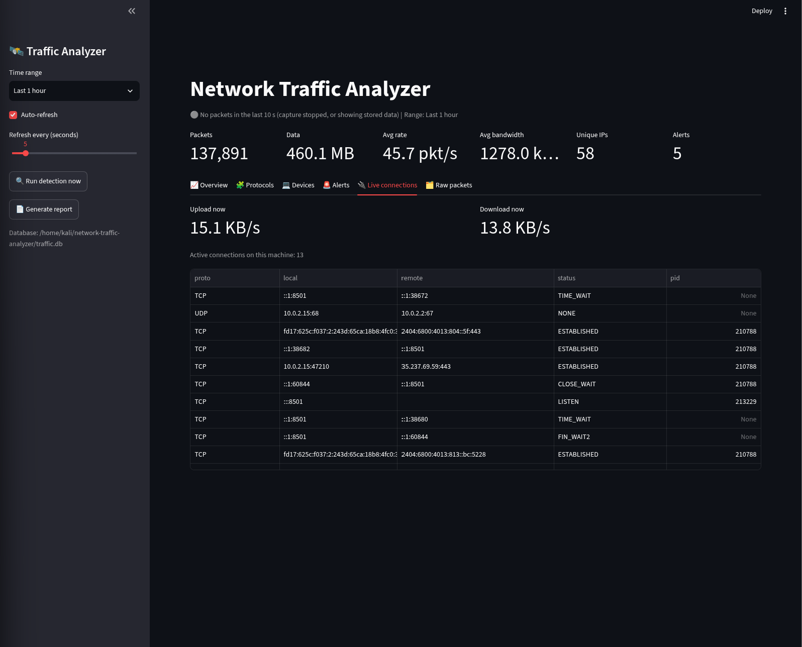
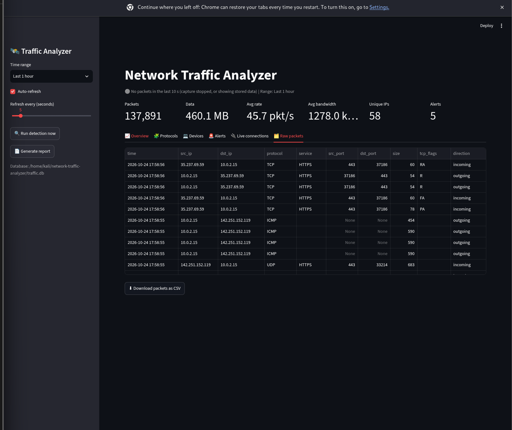
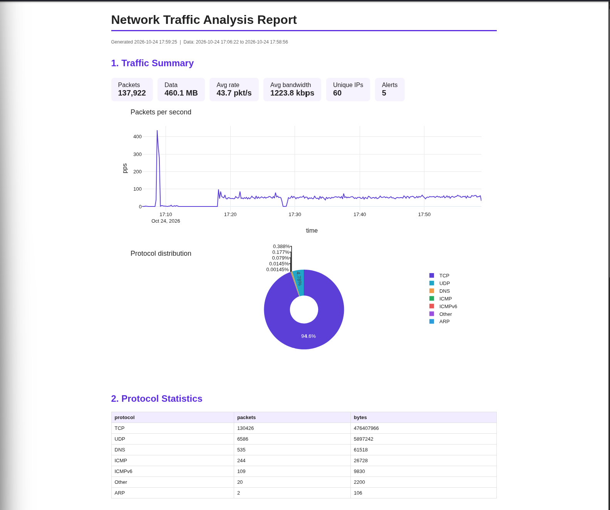
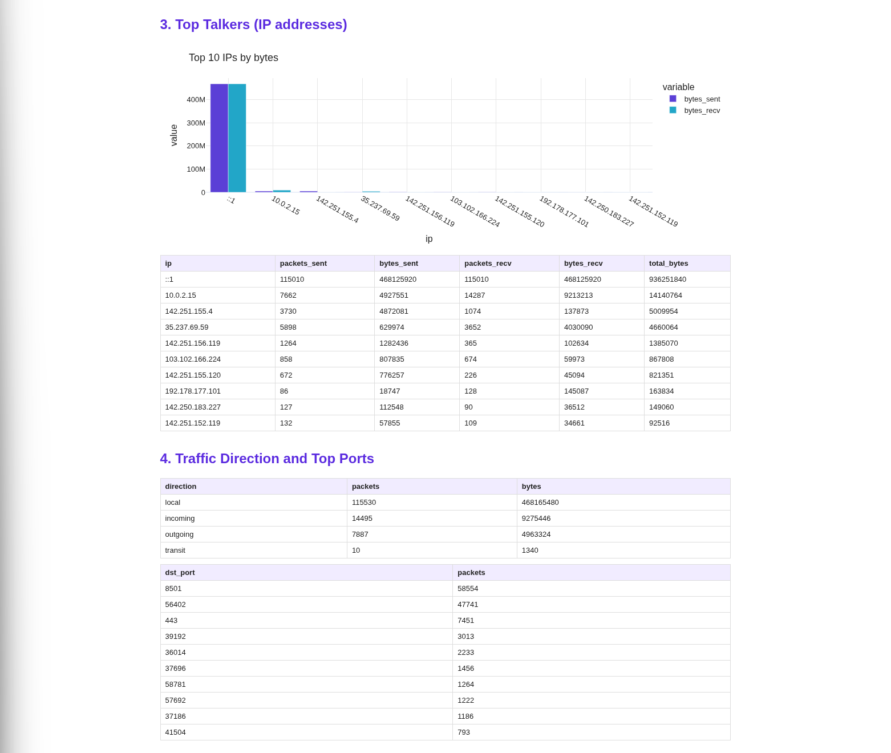
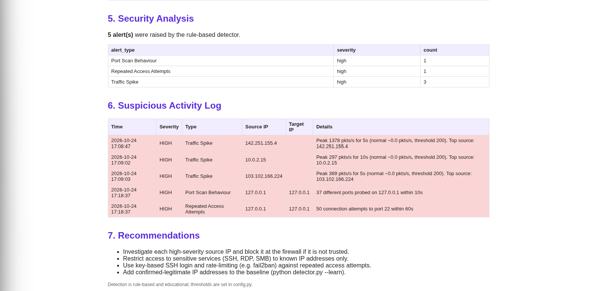

</details>

## Architecture

```
 Scapy sniffer ──► SQLite (traffic.db) ──► analysis.py (Pandas) ──► dashboard.py (Streamlit)
  capture.py          packets                    │                        ▲
                      alerts   ◄── detector.py ──┘                        │
                      known_ips                                  report.py ──► reports/
```

| File | Module | Purpose |
|---|---|---|
| `capture.py` | 1. Packet capture | Sniffs packets, stores IPs, protocols, ports, size, flags, direction |
| `analysis.py` | 2. Traffic monitoring | Bandwidth, protocol usage, device activity, live connections (psutil) |
| `detector.py` | 3. Suspicious activity | 4 rules: traffic spike, unknown IP, port-scan-like, repeated access |
| `dashboard.py` | 4. Dashboard | Live charts, alerts, connections, raw packets |
| `report.py` | 5. Reports | CSV files + HTML security report |
| `db.py`, `config.py` | shared | Database helpers; all thresholds in one place |
| `demo_data.py` | helper | Synthetic traffic for testing without root |

## Setup (Kali Linux)

```bash
bash setup.sh
```

(Creates a virtual environment in `venv/` and installs everything. Always use `./venv/bin/python`.)

## Quick start with sample data (no root)

```bash
bash run_demo.sh          # loads fake traffic + attacks, opens http://localhost:8501
```

## Real use

Open three terminals in the project folder:

```bash
# Terminal 1 - capture (root needed)
bash run_capture.sh

# Terminal 2 - detector (after ~1 min of normal use, learn the baseline once:)
./venv/bin/python detector.py --learn
./venv/bin/python detector.py --watch

# Terminal 3 - dashboard
./venv/bin/streamlit run dashboard.py
```

Generate a report any time:

```bash
./venv/bin/python report.py              # everything
./venv/bin/python report.py --minutes 30 # last 30 minutes
```

Reports appear in `reports/report_<date_time>/` (open `security_report.html`; Ctrl+P gives a PDF).

## Triggering the detector safely (own machine only)

```bash
bash test_traffic.sh spike   # ping flood on loopback   -> Traffic Spike
bash test_traffic.sh scan    # nmap on 127.0.0.1        -> Port Scan Behaviour
bash test_traffic.sh ssh     # repeated connects to :22 -> Repeated Access Attempts
```
The *Unknown IP* rule fires when another device (e.g. your host PC, on a bridged adapter) connects
to the VM after you ran `--learn`.

## Detection rules (tune them in `config.py`)

| Rule | Logic |
|---|---|
| Traffic spike | packets/sec in a 5 s window > median + 3×MAD (robust "mean + 3σ"), minimum 200 pkt/s |
| Unknown IP | inbound TCP SYN from an IP not in the learned baseline / whitelist |
| Port-scan-like | one source sends SYNs to ≥ 15 different ports of one target in 10 s |
| Repeated access | ≥ 15 SYNs to the same sensitive port (SSH, RDP, SMB...) from one source in 60 s |

## Tests

```bash
./venv/bin/python tests/test_parser.py
```

## Limitations

Rule-based detection only (no machine learning, no blocking); IPv6 and encrypted payloads are
analysed by headers only; thresholds need tuning for each network.
